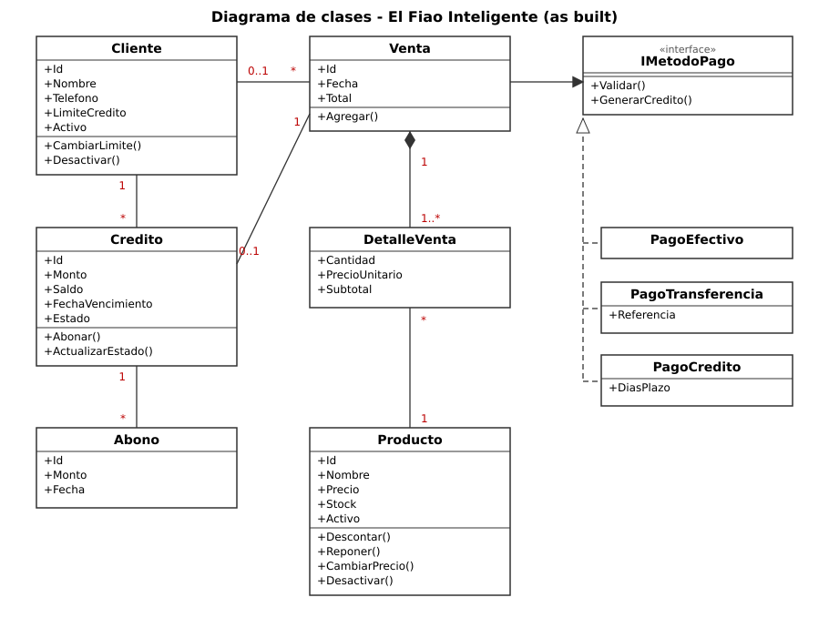
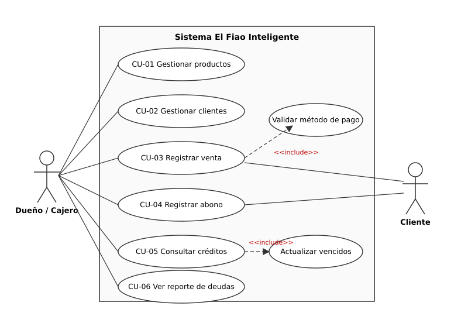

# El Fiao Inteligente (INF512 · Proyecto Final POO)
**Autor:** Virgilio Mejía · Matrícula DB2556

Aplicación de consola en C# (.NET 8) con persistencia en SQLite para un colmado dominicano: inventario, ventas, créditos ("fiao"), abonos y límites de deuda por cliente. Todos los datos son ficticios.

## Cómo ejecutar
Requisitos: **.NET 8 SDK**.
```
git clone <url-del-repositorio>
cd FiaoInteligente
dotnet restore
dotnet run
```
- La base de datos `fiao.db` (SQLite) se crea sola al iniciar, usando `Datos/schema.sql`.
- Para empezar con la base vacía, cierra el programa y borra `fiao.db` (queda junto al ejecutable, en `bin/Debug/net8.0/`).
- No hay contraseñas ni secretos en el repositorio.

## Menú
1. Nuevo producto · 2. Buscar producto · 3. Reponer stock · 4. Desactivar producto
5. Nuevo cliente · 6. Buscar cliente · 7. Nueva venta · 8. Registrar abono
9. Ver créditos de cliente · 10. Reporte de deudas · 11. Cambiar límite de crédito
12. Cambiar precio de producto · 13. Desactivar cliente · 0. Salir

## Arquitectura
Presentación (`Program.cs`) → Lógica (`Servicio.cs` y `Dominio/`) → Datos (`Datos/`).

```
FiaoInteligente/
├── Program.cs               # interfaz de consola
├── Servicio.cs              # procesos con varios objetos (venta, abono)
├── Dominio/                 # clases del dominio y reglas de negocio
├── Datos/                   # SQLite: Db, Repositorio y schema.sql
└── docs/                    # UML y documentación técnica
```

## Reglas de negocio
| # | Tipo | Regla | Dónde |
|---|------|-------|-------|
| R1 | Restricción | No vender más que el stock disponible ni productos desactivados | `Producto.Descontar` |
| R2 | Restricción | No fiar si deuda + compra supera el límite de crédito | `PagoCredito.Validar` |
| R3 | Basada en estado | Crédito Activo pasa a Vencido al pasar la fecha; un cliente con crédito vencido no puede fiar | `Credito.ActualizarEstado`, `PagoCredito.Validar` |
| R4 | Cálculo y estado | El abono reduce el saldo; saldo 0 pasa a Pagado; abono mayor al saldo se rechaza | `Credito.Abonar` |
| R5 | Varios objetos | Una venta descuenta stock, valida al cliente, crea el crédito y guarda todo en una transacción | `ColmadoServicio.RegistrarVenta` |
| R6 | Cálculo | Total de venta = suma de precio unitario × cantidad de cada detalle | `Venta.Total`, `DetalleVenta.Subtotal` |

**Polimorfismo:** la interfaz `IMetodoPago` con `PagoEfectivo`, `PagoTransferencia` y `PagoCredito`. Cada una valida distinto y la venta las usa sin conocer su tipo.
**Reporte (agregación):** `Repositorio.ReporteDeudas` (SUM y GROUP BY).

## UML de clases (versión as built)


## Casos de uso (actor: Dueño / Cajero)


CU-01 Gestionar productos · CU-02 Gestionar clientes · CU-03 Registrar venta · CU-04 Registrar abono · CU-05 Consultar créditos · CU-06 Ver reporte de deudas.

## Matriz de pruebas
Ejecutadas manualmente sobre una base de datos vacía. El detalle de los datos de preparación está en `docs/Documentacion_Tecnica.docx`.

| ID | Regla | Datos iniciales | Acción | Esperado | Obtenido | Estado |
|----|-------|-----------------|--------|----------|----------|--------|
| T-01 | Válido | Producto con stock 10 | Vender 3 en efectivo | Stock = 7 | Venta #1 por $150; Arroz con stock 7 | Aprobada |
| T-02 | R1 | Producto con stock 2 | Vender 3 | Rechazo por stock | `[REGLA] Stock insuficiente de 'Aceite': hay 2, se pidieron 3.` | Aprobada |
| T-03 | R1 límite | Producto con stock 2 | Vender 2 | Aceptada, stock 0 | Venta #2 por $200; Aceite con stock 0 | Aprobada |
| T-04 | Inválido | — | Crear producto con precio 0 | Dato inválido | `[DATO INVÁLIDO] El precio debe ser mayor que 0.` | Aprobada |
| T-05 | R2 | Cliente límite 500, compra 600 | Vender a crédito | Rechazo por límite | `[REGLA] Supera el límite de crédito: deuda $0.00 + compra $600.00 > límite $500.00.` | Aprobada |
| T-06 | R2 límite | Cliente límite 500, compra 500 | Vender a crédito | Aceptada | Venta #3 por $500; crédito #1 con saldo $500, Activo | Aprobada |
| T-07 | R3 | Cliente con crédito vencido (plazo de -1 día) | Nueva venta a crédito | Rechazo | `[REGLA] El cliente tiene un crédito vencido; debe pagar antes de fiar.` | Aprobada |
| T-08 | R4 | Crédito con saldo 300 | Abonar 100 | Saldo 200 | Saldo $200.00, Activo | Aprobada |
| T-09 | R4 | Crédito con saldo 200 | Abonar 200 | Estado Pagado | Saldo $0.00, Pagado | Aprobada |
| T-10 | R4 | Crédito con saldo 100 | Abonar 150 | Rechazo | `[REGLA] El abono ($150.00) supera el saldo ($100.00).` | Aprobada |
| T-11 | R5 | Venta con un producto inexistente | Vender Arroz y producto 99 | Nada se guarda | `[REGLA] Producto 99 no existe.`; Arroz sigue con stock 17 | Aprobada |
| T-12 | Transferencia | — | Transferencia sin referencia | Rechazo | `[REGLA] La transferencia requiere número de referencia.` | Aprobada |
| T-13 | Persistencia | Datos creados | Cerrar y abrir la app | Los datos siguen | Productos, clientes y créditos intactos | Aprobada |
| T-14 | R3 estado | Crédito con fecha pasada | Ver créditos del cliente | Estado Vencido guardado en BD | Primera ejecución: Vencido en pantalla pero Activo en la BD (defecto D-01). Tras la corrección, queda guardado | Aprobada (tras corrección) |

## Defecto detectado y corregido
**D-01: el estado "Vencido" de un crédito no se guardaba en la base de datos.**
- **Detectado en:** T-14. La opción 9 mostraba `[Vencido]` en pantalla, pero la tabla `Credito` tenía el crédito 4 con `Estado = Activo`.
- **Causa:** `Credito.ActualizarEstado` cambiaba solo el objeto en memoria y el servicio no escribía el cambio en la BD.
- **Corrección:** se agregó `ColmadoServicio.CreditosActualizados`, que actualiza el estado y lo guarda cuando cambia. Se usa al vender, al abonar y al consultar créditos.
- **Commit:** la corrección ya estaba aplicada al crear el repositorio, por lo que está incluida en el commit inicial `37396c4`.

## Uso de Inteligencia Artificial (Ruta A)
| Elemento | Detalle |
|---|---|
| Herramienta | Claude (Anthropic) |
| Propósito | Generar la base del proyecto (clases, persistencia, documentación) a partir de la guía oficial. |
| Prompt relevante | Se entregó la guía del proyecto y se pidió una solución en C# para la narrativa "El Fiao Inteligente". |
| Propuesta recibida | 9 clases de dominio, polimorfismo con `IMetodoPago`, SQLite con SQL directo, README y matriz de pruebas. |
| Aceptado | La estructura en capas, las clases, la interfaz de pagos y el esquema de la BD. |
| Modificado | El menú pasó a lista vertical, se agregaron las opciones 11 a 13 y se corrigieron errores de sintaxis al editar `Program.cs`. Tras T-14 se aplicó la corrección de D-01. |
| Verificación | Compilación y ejecución en Visual Studio (.NET 8); 14 pruebas manuales; revisión de la tabla `Credito` con DB Browser for SQLite. |
| Aprendizaje | • **Traducir reglas reales a código:** aprendí a proteger la lógica de un negocio cotidiano (el "fiao" de un colmado) validando inventario, límites de crédito y deudas vencidas para evitar datos inconsistentes.<br>• **Aplicar POO con sentido práctico:** entendí cómo el diseño de clases y el polimorfismo (por ejemplo, en los métodos de pago) hacen el código más limpio, escalable y fácil de mantener.<br>• **Integrar todo el ciclo de desarrollo:** vi que programar no es solo escribir código, sino también diseñar diagramas UML, persistir datos en SQLite, ejecutar pruebas y documentar cada entrega.<br>• **Trabajar con rigor profesional:** usar Git con versiones (`v1.0`), declarar el uso de herramientas de IA con transparencia y dominar el sistema para defenderlo y modificarlo en vivo. |

Todo el código entregado fue revisado y es responsabilidad de quien lo entrega.
