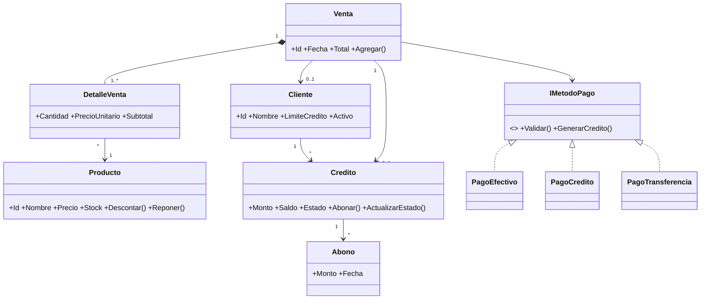

# El Fiao Inteligente (INF512 · Proyecto Final POO)
Sistema de colmado: inventario, ventas, créditos (fiao), abonos y límites de deuda. Datos ficticios.

## Ejecutar
Requisitos: .NET 8 SDK.
```
dotnet restore
dotnet run
```
La BD `fiao.db` (SQLite) se crea sola al iniciar con `Datos/schema.sql`. Para reiniciarla, borra `fiao.db`.

## Arquitectura
UI (`Program.cs`) → Lógica (`Servicio.cs` + `Dominio/`) → Datos (`Datos/`).

## Reglas de negocio
| # | Tipo | Regla | Dónde |
|---|------|-------|-------|
| R1 | Restricción | No vender más que el stock disponible | `Producto.Descontar` |
| R2 | Restricción | No fiar si deuda + compra > límite de crédito | `PagoCredito.Validar` |
| R3 | Estado | Crédito Activo → Vencido al pasar la fecha; Vencido bloquea nuevo fiao | `Credito.ActualizarEstado`, `PagoCredito.Validar` |
| R4 | Cálculo + estado | Abono reduce saldo; saldo 0 → Pagado; abono > saldo se rechaza | `Credito.Abonar` |
| R5 | Múltiples objetos | Venta descuenta stock, crea crédito y valida cliente en una transacción | `ColmadoServicio.RegistrarVenta` |

Polimorfismo: `IMetodoPago` → `PagoEfectivo`, `PagoCredito`, `PagoTransferencia`.
Reporte/agregación: `Repositorio.ReporteDeudas` (SUM + GROUP BY).

## UML de clases (versión inicial; actualizar "as built" al final)


## Casos de uso (Actor: Cajero/Dueño)
Gestionar productos · Gestionar clientes · Registrar venta · Registrar abono · Consultar créditos · Ver reporte de deudas.

## Matriz de pruebas (completar "Resultado obtenido" ejecutando la app)
| ID | Regla | Datos iniciales | Acción | Esperado | Obtenido | Estado |
|----|-------|-----------------|--------|----------|----------|--------|
| T-01 | Válido | Producto stock 10 | Vender 3 en efectivo | Stock = 7 | | |
| T-02 | R1 | Producto stock 2 | Vender 3 | Rechazo por stock | | |
| T-03 | Límite R1 | Producto stock 2 | Vender 2 | Aceptada, stock 0 | | |
| T-04 | Inválido | — | Crear producto precio 0 | Dato inválido | | |
| T-05 | R2 | Cliente límite 500, total 600 | Vender a crédito | Rechazo por límite | | |
| T-06 | R2 límite | Cliente límite 500, total 500 | Vender a crédito | Aceptada | | |
| T-07 | R3 | Crédito vencido | Nuevo fiao | Rechazo | | |
| T-08 | R4 | Crédito saldo 300 | Abonar 100 | Saldo 200 | | |
| T-09 | R4 | Crédito saldo 200 | Abonar 200 | Estado Pagado | | |
| T-10 | R4 | Crédito saldo 100 | Abonar 150 | Rechazo | | |
| T-11 | R5 | Venta a crédito fallida | Forzar error | Nada se guarda (transacción) | | |
| T-12 | Transf. | — | Transferencia sin referencia | Rechazo | | |
| T-13 | Persistencia | Datos creados | Cerrar y abrir app | Datos siguen | | |

**Defecto detectado y corregido (obligatorio):** *(documenta aquí uno real que encuentren, con el commit que lo corrige).*

## Uso de IA (Ruta A: completar con su caso real)
Herramienta: Claude · Propósito: generar base del proyecto · Aceptado/Modificado/Verificación/Aprendizaje: *(completar)*.

## Pendiente antes de entregar
Compilar, probar cada fila de la matriz, hacer commits por unidad lógica, tag `v1.0`, UML "as built".
